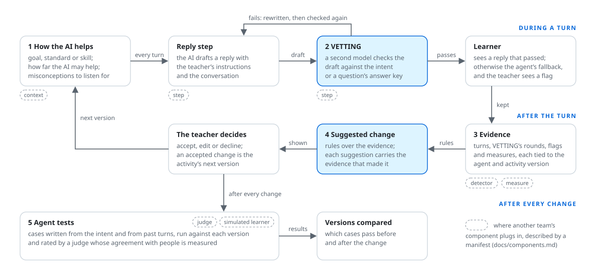
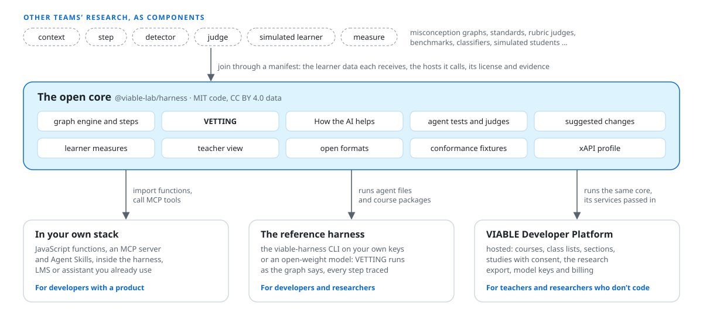

<p align="center">
  
</p>

<p align="center">
  <a href="https://github.com/VIABLE-Learning-Lab/viable-harness/actions/workflows/test.yml"></a>
  <a href="LICENSE"></a>
  <a href="NOTICE"></a>
  
  <a href="docs/mcp.md"></a>
  <a href="skills/"></a>
</p>

<p align="center">
  <a href="#quick-start"><b>Quick start</b></a> ·
  <a href="docs/guide.md"><b>Guide</b></a> ·
  <a href="docs/components.md"><b>Components</b></a> ·
  <a href="docs/mcp.md"><b>MCP</b></a> ·
  <a href="CONTRIBUTING.md"><b>Contributing</b></a>
</p>

**VIABLE harness** is the open core of the [VIABLE Developer Platform](https://developers.viablelab.org):
the layer between AI models and learners that turns what a teacher intends into what the AI does with
each learner, checks what it says before the learner sees it, and keeps the evidence of what
happened. Use its parts inside the tools you already have, run the whole loop on your own model keys,
or let the developer platform host it for you.

## Why

AI tutors and feedback tools now work with students out of their teacher's sight. Teachers rarely
know what the AI was told, have few ways to steer it, and can't tell whether a change they made
helped. Education's public goods (standards, misconception data, rubrics, benchmarks) could help,
but each one takes work to wire in and test. The harness makes them part of one loop that the teacher
governs, in code anyone can read, run and build on.

## How it works

<p align="center">
  
</p>

1. **The teacher's intent reaches the AI on every turn.** How the AI helps (a goal, a K-12 standard
   or durable skill, how far the AI may go, misconceptions to listen for, a section's own level and
   note) becomes part of the instructions of every step that writes a reply.
2. **A second model checks each reply before the learner sees it.** VETTING keeps the reviewer's
   rules apart from the reply model, so a learner can't talk the reviewer out of them. A failed draft
   is rewritten and checked again; a reply that never passes becomes the agent's fallback and a flag
   for the teacher ([Li, Zhang & Botelho, 2026](https://doi.org/10.1016/j.caeai.2026.100646)).
3. **The evidence is tied to the version that produced it**: turns, VETTING's rounds, flags and
   twenty research measures, each defined in the open with its caveats and sources.
4. **The evidence becomes suggested changes**, each carrying the evidence that made it, and the
   teacher accepts, edits or declines. An accepted change is the activity's next version.
5. **Tests written from the intent run again after every change**, so a change shows whether it
   helped before learners meet it.

## Quick start

Node 22 or later, and any OpenAI-compatible endpoint: OpenAI, or an open-weight model behind Ollama,
vLLM, llama.cpp or LM Studio.

```sh
git clone https://github.com/VIABLE-Learning-Lab/viable-harness.git
cd viable-harness && npm install && npm link   # npm link puts viable-harness on your path
export OPENAI_API_KEY=sk-...                    # or OPENAI_BASE_URL=http://localhost:11434/v1 for Ollama
export MODEL=gpt-4.1-mini                       # any chat model your endpoint serves
```

**Run a tutor that checks itself.** The fractions tutor drafts a reply and a second model reviews it
against the question's answer key; the trace shows each round's verdict and the reviewer's reason.

```sh
echo '{"question": "What is 1/2 + 1/3?", "answer_key": "5/6"}' > question.json
viable-harness run examples/fractions-practice.json --model "$MODEL" --context question.json \
  --input "Just tell me the answer"
```

**Check a reply your own app wrote**, before a learner sees it:

```sh
viable-harness check --model "$MODEL" --reply "It's 5/6." \
  --question "What is 1/2 + 1/3?" --answer-key "5/6"
# round 1 (draft): fail: … states the answer …
# outcome: unverified
```

**See it as a teacher would.** Keep runs with `--json`, then make one page with How the AI helps,
what VETTING did, the measures and the suggested changes:

```sh
viable-harness run examples/fractions-practice.json --model "$MODEL" --context question.json \
  --input "Just tell me the answer" --json > run-1.json
viable-harness view run-1.json examples/fractions-practice.json --out class.html
```

A local run sends nothing to VIABLE: the learner's message, the agent's instructions and any context
go to the endpoint you chose (its chat, speech and image routes), and nowhere else. Before learners
use what you build, read [deploying.md](docs/deploying.md).

## Use it your way

<p align="center">
  
</p>

| | Start with | What you can count on |
| --- | --- | --- |
| **In your own stack** | `npm install github:VIABLE-Learning-Lab/viable-harness`, then `import { checkReply } from '@viable-lab/harness'`; or `viable-harness mcp` in your assistant ([MCP](docs/mcp.md)) and the [Agent Skills](skills/) | the same checks VIABLE runs; your host decides whether they run and what is kept |
| **The reference harness** | `viable-harness run`, `test`, `view` on agent files and course packages ([guide](docs/guide.md)) | VETTING runs where the graph says; every step is traced; nothing leaves your machine but model calls |
| **[VIABLE Developer Platform](https://developers.viablelab.org)** | build agents, courses and studies in the browser; learners open activities on the [VIABLE Learning Platform](https://viablelearning.org) | the same core, hosted, with class lists, sections, consent, the research export and support |

## What's inside

| | What it does | Where |
| --- | --- | --- |
| **VETTING** | A second model checks a reply against a guideline or an answer key and the activity's teaching settings; failed drafts are rewritten or flagged. | `checkReply`, `check`, `check_reply` |
| **How the AI helps** | An activity's goal, standard or skill, help level, misconceptions and sections, turned into the instructions every reply step gets. | [guide](docs/guide.md) |
| **Graph engine** | Runs agent files and course packages: 22 step types, from LLM, Router and Agent to Knowledge, Speech, Loop and VETTING. | [step manifests](docs/step-manifests.md) |
| **Agent tests** | Cases drafted from the intent or taken from past turns, run against each version and rated by a judge whose agreement with people you can measure. | [agent tests](docs/agent-tests.md) |
| **Suggested changes** | Rules over the evidence propose changes to How the AI helps, each with its evidence; the teacher decides. | `suggest`, `suggest_changes` |
| **Teacher view** | One self-contained page of what the AI did with a class, and why. | `view` |
| **Learner measures** | Twenty measures over learning events (sessions, think time, revision, pasting, mastery, wheel-spinning…), each with its definition, caveats and sources. | `measure`, `compute_measures` |
| **Components** | Other teams' work in six slots, each with a manifest that states the learner data it receives, the hosts it calls, its license and its evidence; out-of-process components are called from their manifests, with only the data they list. | [components](docs/components.md), [template](integrations/_template/) |
| **MCP server and Agent Skills** | Tools and skills for the assistants and agent SDKs people already use. | [MCP](docs/mcp.md), [skills](skills/) |
| **Open formats** | Agent files, course packages, learning events, teaching settings and component manifests as JSON Schema, with conformance cases another implementation can check itself against. | [conformance](conformance/README.md) |
| **xAPI profile** | Learning events as xAPI statements for a school's learning record store, with no learner text unless asked for. | [xAPI](docs/xapi.md) |

## Education's public goods, inside the loop

| Component | Slot | From |
| --- | --- | --- |
| VETTING reply check | step | Li, Zhang & Botelho (2026), peer reviewed |
| Eedi Misconceptions Graph: 8,117 misconceptions, 2,258 constructs | context | Eedi, via Learning Commons (CC BY 4.0) |
| K-12 standards with their learning components | context | Learning Commons Knowledge Graph (CC BY 4.0) |
| Carnegie Skills Progressions | context | Carnegie Foundation, via Learning Commons (CC BY 4.0) |
| Learner measures | measure | the research each measure cites |
| Agent test judge | judge | VIABLE Lab |

Each has a page with what its authors showed, what comparisons in the harness showed and what nobody
has shown yet, kept apart on purpose ([components](docs/components.md)). Built something a teacher's
AI should use? [Propose a component](../../issues/new?template=component.yml).

## Privacy and safety

The harness is used with minors, so its defaults protect them wherever it runs:

- No learner's name or identifier reaches a model from the core. How the AI helps is set per activity
  or section, never per learner.
- Every model call goes through one call point a host can record; a local run keeps its trace on the
  machine.
- A component receives only the learner data its manifest lists.
- VETTING's outcomes are explicit (passed, unverified, needs attention): anything but passed is a
  flag, never a checked reply.
- What a tool or a fetched page returns is data for the model, never instructions to it.

Using the harness doesn't make a deployment compliant with COPPA, FERPA or any other law by itself:
[deploying.md](docs/deploying.md) lists what a deployer still has to do. Report vulnerabilities
privately ([SECURITY.md](SECURITY.md)).

## Status

Version 0.2, a preview. The formats, the command line and the functions above are ready to build on;
changes to them follow semantic versioning, with a note on moving existing files
([CHANGELOG](CHANGELOG.md)). Next: step components inside agent graphs, the first components from
other teams (Learning Commons' Evaluators as judges, then MathTutorBench), and MCP Apps that show a
VETTING round inside an assistant.

## Contributing

Issues, discussions and pull requests are welcome, from a typo to a new component.
[CONTRIBUTING.md](CONTRIBUTING.md) covers setting up, testing, proposing a change, and how a pull
request is reviewed and merged. Look for [good first issues](../../labels/good%20first%20issue), ask
in [Discussions](../../discussions), and follow the [code of conduct](CODE_OF_CONDUCT.md).

## Citing

If you use the harness in research, cite it with [CITATION.cff](CITATION.cff) (GitHub's "Cite this
repository"), and cite VETTING as: Li, H., Zhang, S., & Botelho, A. F. (2026). VETTING: A dual-LLM
framework for in-loop safety verification via policy isolation in educational AI. *Computers and
Education: Artificial Intelligence, 11*, 100646.

## License

Code under [MIT](LICENSE). The data the harness carries (Learning Commons Knowledge Graph standards,
the Carnegie Skills Progressions and Eedi's Misconceptions Graph) stays under CC BY 4.0, with the
attribution to keep with it in [NOTICE](NOTICE). The names VIABLE and VETTING: [TRADEMARKS.md](TRADEMARKS.md).

Made by [VIABLE Lab](https://viablelab.org).
