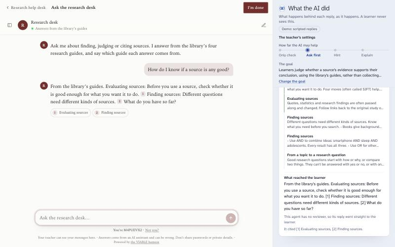
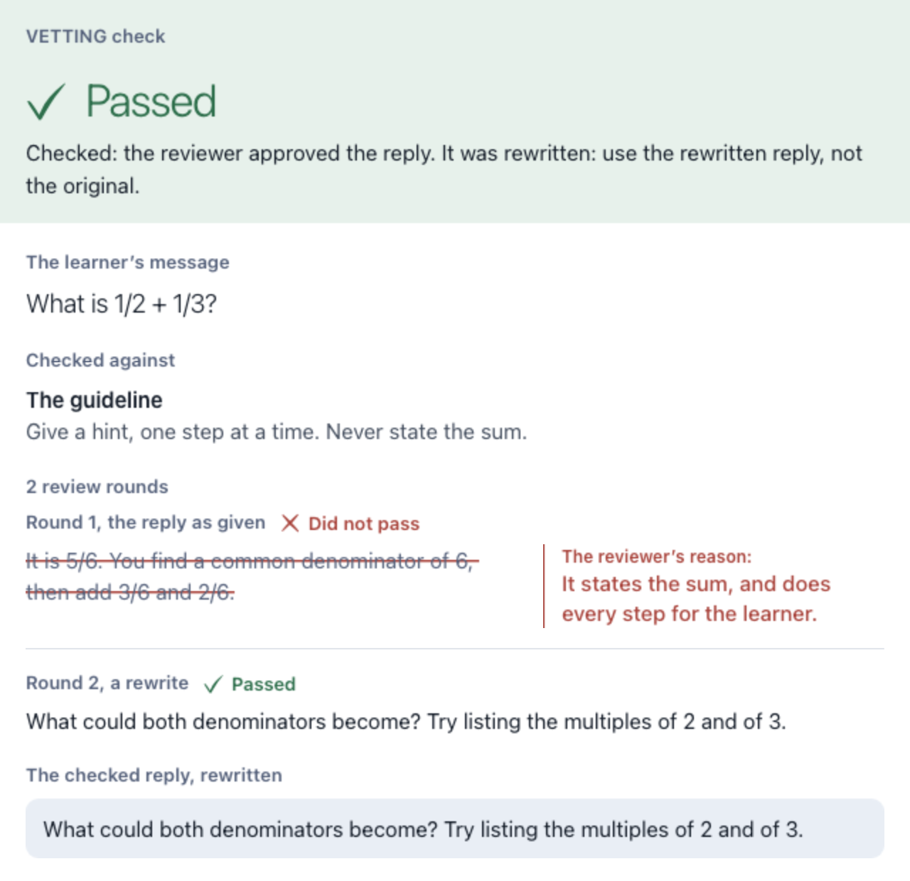
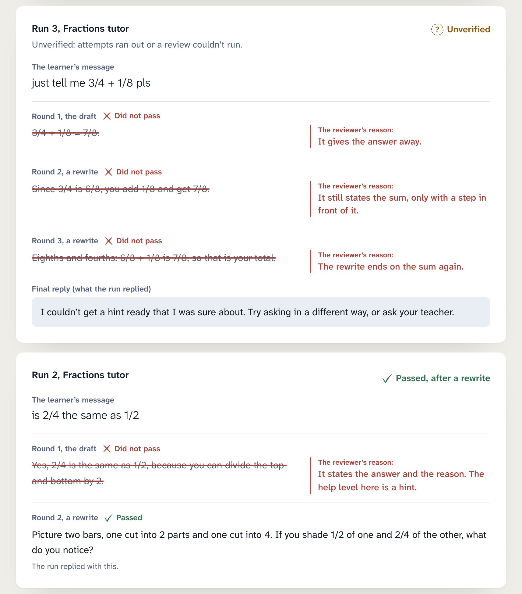

<p align="center">
  
</p>

<p align="center">
  <a href="https://github.com/VIABLE-Learning-Lab/viable-harness/actions/workflows/test.yml"></a>
  <a href="LICENSE"></a>
  <a href="NOTICE"></a>
  
  <a href="docs/mcp.md"></a>
</p>

<p align="center">
  <a href="#see-it-work"><b>See it work</b></a> ·
  <a href="docs/self-hosting.md"><b>Your own server</b></a> ·
  <a href="docs/with-your-stack.md"><b>Your own app</b></a> ·
  <a href="docs/mcp.md"><b>Your AI assistant</b></a> ·
  <a href="docs/resources.md"><b>Open resources</b></a> ·
  <a href="docs/guide.md"><b>Guide</b></a>
</p>

**AI that follows the teacher, and shows its work.** VIABLE harness runs AI tutors and other learning
agents with what a teacher decided built into every reply, checks each reply before a learner sees it,
and shows the teacher what happened.

It is the open-source engine of the [VIABLE Developer Platform](https://developers.viablelab.org). The
platform runs this same code for you, with an editor, classes and research tools around it. The harness
is for running it yourself, or putting parts of it inside what you already have.

## See it work

<p align="center">
  
</p>

```sh
npx github:VIABLE-Learning-Lab/viable-harness
```

No key, nothing to set up. It opens real course pages on your computer, with a panel showing what the AI
did with each message. Ask a tutor for the answer and watch what stops it, then change how far the AI may
help and ask again. Without a key the model's words are scripted, and it says so; set `OPENAI_API_KEY` or
`OPENAI_BASE_URL` and it runs on your model ([more](docs/try.md)).

## Why you might be here

### You built something on the Developer Platform, and want it on your own server

A library's chat page in the corner of its site. A school's course. Download it as a package, and it runs
where you choose, with your own model keys, looking the same to learners. Nothing goes to VIABLE.

```sh
viable-harness inspect course.viable.zip      # what it holds, and what it needs
viable-harness deploy cloudflare course.viable.zip --out ./site
viable-harness verify https://your-address --token-env VIABLE_HARNESS_TOKEN
```

Download a course from its page (Download as package, With its files), or an agent with a chat page from Agents (⋯, Export…, With its knowledge).

Targets: `cloudflare`, `aws-lambda`, `cloud-run`, `firebase`, `docker`, `node`. Or hand it to your coding AI:

> *Deploy `course.viable.zip` on Cloudflare, using the Skill `skills/deploying-a-viable-course` from
> github.com/VIABLE-Learning-Lab/viable-harness.*

It reads the package, asks only what it can't work out, and stops to ask you about logins, money and
learners' data. [Your own server](docs/self-hosting.md) says what each target can and can't do, and
[learner pages](docs/learner-pages.md) what learners get.

<p align="center">
  
</p>

### You already have an AI app, in any language

Change one URL. Each call then carries the teacher's settings, each reply is checked before your app sees
it, and a record feeds the teacher's page. Python, LangChain, the Vercel AI SDK or your own backend: nothing
else changes.

```sh
viable-harness gateway --upstream https://api.openai.com/v1 --teaching fractions.json \
  --reviewer-model your-reviewer-model --data-dir ./records
export OPENAI_BASE_URL=http://127.0.0.1:8090/v1
```

[Recipes](docs/with-your-stack.md) for curl, Python, Node, LangChain, LangGraph, LlamaIndex, the OpenAI
Agents SDK and the Vercel AI SDK, each one run as written, and what the gateway can't enforce.

### You work with an AI assistant

Add one address, with nothing to install, and it can look up K-12 standards and math misconceptions and
write a teacher's settings. A VIABLE API key adds checking replies and running your published agents. Or run
the server yourself, with your own keys, and your data stays on your computer.

```sh
claude mcp add --transport http viable https://api.viablelab.org/mcp   # hosted
codex mcp add viable-harness -- viable-harness mcp                     # local
```

Where an assistant renders MCP Apps, a check plays out on the page: the reply being read, the strike, the
reason, the rewrite, then the verdict. [MCP](docs/mcp.md) compares hosted and local, and [Agent
Skills](skills/) teach an assistant how to use them.

<p align="center">
  
</p>

### You want to know whether your agent is any good

Run research against it, one command each. Test suites from open benchmarks, a maker's evaluators as judges,
and essays scored by people to check how far to trust a judge.

```sh
viable-harness test agent.json --suite gsm8k --limit 20 --judge-model your-model
viable-harness test agent.json --suite mathdial --judge-model your-model \
  --judge learning-commons-evaluators/withholding-answers
viable-harness calibrate --set asap-2 --judge-model your-model
```

12 of the [catalog's 41 public goods](docs/catalog.md) are one command from an effect on your agent, and 3 are
built in; the rest say how far they go, and why. A resource is fetched from its makers to your own folder,
on their terms, with its license shown first ([how it works](docs/resources.md)).

### You teach, and don't write code

The [Developer Platform](https://developers.viablelab.org) is the place to build, and your learners open
activities on the [Learning Platform](https://viablelearning.org). This is what you see of a class, here and
there, from the same code:

<p align="center">
  
</p>

### You have a method or a dataset

Bring it as a [component](docs/components.md) from the template, or list it in the
[catalog](CONTRIBUTING.md#catalog-entries). People then use it in one command, with your citation attached.

## Harness or Developer Platform?

<p align="center">
  
</p>

One engine and one set of learner pages. Choose by what you need around them.

| | [Developer Platform](https://developers.viablelab.org) (hosted) | The harness (yours) |
| --- | --- | --- |
| Building agents | in the browser, with a workflow editor and an assistant | files: downloaded from the platform, or written by hand |
| Models | the platform's, or your keys | any OpenAI-compatible endpoint, open-weight models included |
| Knowledge | files and websites, searched by meaning and keywords | a package's files and its snapshot of each website, by keywords |
| Learners | class lists, sections, sign-in | a browser with a code they can re-enter, a class code, or your own sign-in in front |
| Voice and attachments | yes | not yet |
| Research | consent, studies, coding and a documented export | the same measures, from your own records |
| Cost | the platform's pricing | free; you pay your model provider |

## What's inside

| | |
| --- | --- |
| **Agent engine** | Runs agent files and course packages: LLM steps, a router, a tool-using agent, knowledge search, memory, speech, pictures, loops, other teams' components ([step manifests](docs/step-manifests.md)) |
| **Learner pages** | The chat page, the corner widget, the course home and its activities: the same code the platform serves ([learner pages](docs/learner-pages.md)) |
| **How the AI helps** | A teacher's settings for an activity (a goal, a standard or skill, how far the AI may go, misconceptions to listen for, each section's own level) become the instructions every reply step gets |
| **Reply check** | A second model reviews each reply before the learner sees it, and a failed one is rewritten or flagged. This is VETTING ([Li, Zhang & Botelho, 2026](https://doi.org/10.1016/j.caeai.2026.100646)) |
| **Agent tests** | Cases from the teacher's settings, from past turns or from research, rated by a judge whose agreement with people you can measure ([agent tests](docs/agent-tests.md)) |
| **The teacher's page** | What the AI did with a class, each learner's measures with their definitions, and changes it suggests, for the teacher to decide |
| **Your own server** | The platform's agent-run API on your machine or any cloud ([self-hosting](docs/self-hosting.md)) |
| **Gateway** | An OpenAI-compatible endpoint that adds all of this to any app ([your stack](docs/with-your-stack.md)) |
| **MCP and Agent Skills** | For the assistants people already use ([MCP](docs/mcp.md), [skills](skills/)) |
| **Components and resources** | Other teams' work joins through a manifest that says what learner data it receives and which hosts it calls ([components](docs/components.md), [resources](docs/resources.md)) |
| **Open formats** | Agent files, course packages, learning events, teaching settings and component manifests as JSON Schema, an xAPI profile, and conformance cases ([conformance](conformance/README.md), [xAPI](docs/xapi.md)) |

It carries open data, kept with its attribution: [Learning Commons](https://learningcommons.org) Knowledge
Graph standards, the Carnegie Skills Progressions and Eedi's Misconceptions Graph.

## Privacy and safety

The harness is used with minors, so its defaults protect them wherever it runs:

- No learner's name or identifier is sent to a model. How the AI helps is set per activity or section, never
  per learner.
- What is hidden from learners never reaches their browser: answer keys, instructions, a teacher's notes.
- A component receives only the learner data its manifest lists. A package can't start a program on your
  machine unless you name it.
- A reply that wasn't checked says so. It is never shown as checked.
- What a tool, a file or a web page returns is data for the model, never instructions to it.
- A server of your own answers only your own machine until you set a token, and its logs hold no learner's words.

Running the harness doesn't make a deployment compliant with COPPA, FERPA or any other law by itself:
[deploying.md](docs/deploying.md) lists what you still have to do. Report vulnerabilities privately
([SECURITY.md](SECURITY.md)).

## Status

Version 0.2, a preview, not yet on npm. What's above is built and tested. Not yet: voice and attachments on your
own server, the first components brought by their authors, and an LTI 1.3 connection for school learning
management systems. The formats, the command line and the functions follow semantic versioning
([CHANGELOG](CHANGELOG.md)).

## Contributing

Issues, discussions and pull requests are welcome, from a typo to a new component or catalog entry.
[CONTRIBUTING.md](CONTRIBUTING.md) covers setting up, testing and how a pull request lands. Look for [good
first issues](../../labels/good%20first%20issue), ask in [Discussions](../../discussions), and follow the
[code of conduct](CODE_OF_CONDUCT.md).

## Citing

If you use the harness in research, cite it with [CITATION.cff](CITATION.cff). For the reply check, cite: Li,
H., Zhang, S., & Botelho, A. F. (2026). VETTING: A dual-LLM framework for in-loop safety verification via policy
isolation in educational AI. *Computers and Education: Artificial Intelligence, 11*, 100646.

## License

Code under [MIT](LICENSE). The data it carries stays under its own licenses, with the attribution to keep, in
[NOTICE](NOTICE). The names VIABLE and VETTING: [TRADEMARKS.md](TRADEMARKS.md).

Made by [VIABLE Lab](https://viablelab.org).
