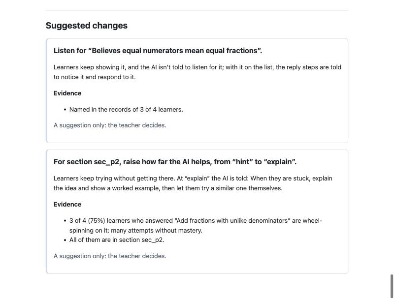

<p align="center">
  
</p>

<p align="center">
  <a href="https://github.com/VIABLE-Learning-Lab/viable-harness/actions/workflows/test.yml"></a>
  <a href="LICENSE"></a>
  <a href="NOTICE"></a>
  
  <a href="docs/mcp.md"></a>
</p>

<p align="center">
  <a href="#quick-start"><b>Quick start</b></a> ·
  <a href="docs/self-hosting.md"><b>Your own server</b></a> ·
  <a href="docs/mcp.md"><b>MCP</b></a> ·
  <a href="docs/catalog.md"><b>Open resources</b></a> ·
  <a href="docs/guide.md"><b>Guide</b></a> ·
  <a href="CONTRIBUTING.md"><b>Contributing</b></a>
</p>

**VIABLE harness** is the open-source engine of the [VIABLE Developer Platform](https://developers.viablelab.org).
It runs AI tutors and other learning agents, puts what the teacher decided into every reply (the
goal, how far the AI may help, the misconceptions to listen for), checks replies before a learner
sees them, and records what happened so a teacher can see it and change it.

The Developer Platform runs this same code for you, with a workflow editor, classes, consent and
research tools around it. The harness is that engine on its own, under the MIT license, for when you
want to run it yourself.

> An *agent harness* is the software around an AI model: what the model is told, what it may do, and
> what is checked before anyone sees its answer. This one is built for learning.

## What you can do with it

| You want to | Use | Start with |
| --- | --- | --- |
| Run a course or agent you built on the Developer Platform on your own server, with your own model keys | `viable-harness serve course.viable.zip` | [Your own server](docs/self-hosting.md) |
| Give your own AI app a teacher's settings and a check on each reply | the JavaScript functions, or `serve` | [Guide](docs/guide.md#from-code) |
| Let your AI assistant write teaching settings, check replies and read learner evidence | `viable-harness mcp` and four Agent Skills | [MCP](docs/mcp.md) |
| Test an agent before learners meet it, and know how far to trust the judge | `viable-harness test`, `draft-tests`, `calibrate` | [Agent tests](docs/agent-tests.md) |
| Find open datasets, benchmarks and tools for K-12 AI, and how each could plug in | `viable-harness catalog` | [Open resources](docs/catalog.md) |
| Plug your own research method into an agent | a component manifest | [Components](docs/components.md) |

## Harness or Developer Platform?

<p align="center">
  
</p>

They are one engine: an agent behaves the same in both. Choose by what you need around it.

| | [Developer Platform](https://developers.viablelab.org) (hosted) | The harness (yours) |
| --- | --- | --- |
| Building agents | in the browser, with a workflow editor and an assistant | agent files and course packages: downloaded from the platform or written by hand |
| Models | the platform's, or your keys | any OpenAI-compatible endpoint: OpenAI, or an open-weight model on Ollama, vLLM, llama.cpp or LM Studio |
| Knowledge | files and websites, searched by meaning and keywords | a package's files, searched by keywords |
| Learners | courses, class lists, sections and sign-in; learners open activities on the [VIABLE Learning Platform](https://viablelearning.org) | your app says who the learner is |
| Research | consent, studies, coding and a documented export | the same measures, from your own records |
| Cost | the platform's pricing | free; you pay your model provider |

## Quick start

You need [Node.js](https://nodejs.org) 22 or later.

**1. Install.**

```sh
git clone https://github.com/VIABLE-Learning-Lab/viable-harness.git
cd viable-harness && npm install && npm link    # npm link puts viable-harness on your path
```

**2. Try it without a model key.** The harness carries a copy of Eedi's math misconceptions, so it can
tell you what learners get wrong about a topic:

```sh
viable-harness misconceptions "adding fractions with unlike denominators"
```

`examples/class/` holds four made-up learners' records from the fractions practice in
`examples/fractions-practice.json`. Ask what the evidence suggests changing, then open the page a
teacher would see:

```sh
viable-harness suggest examples/class/*.json examples/fractions-practice.json
viable-harness view examples/class/*.json examples/fractions-practice.json --out class.html
```

<p align="center">
  
</p>

**3. Run a tutor.** Point the harness at a model, then ask the fractions tutor for the answer. Its
teacher set it to give hints, and its check step reviews each draft against the question's answer key,
so it nudges instead of telling:

```sh
export OPENAI_API_KEY=sk-...          # or OPENAI_BASE_URL=http://localhost:11434/v1 for Ollama
echo '{"question": "What is 1/2 + 1/3?", "answer_key": "5/6"}' > question.json
viable-harness run examples/fractions-practice.json --model gpt-4.1-mini --context question.json \
  --input "Just tell me the answer"
```

It prints the reply, then each step: what the reviewer said about the first draft and why it was
rewritten.

**4. Serve it to an app.** The same course answers HTTP requests the way the Developer Platform does:

```sh
viable-harness serve examples/fractions-practice.json --model gpt-4.1-mini
curl -s http://127.0.0.1:8080/v1/agents/agent-1/runs -H 'Content-Type: application/json' \
  -d '{"input": "Is 2/4 the same as 1/2?", "user": "my-app:student-0001"}'
```

**5. Use it from your assistant.** Add the MCP server, then ask in plain words, for example "write How
the AI helps for a 5th-grade practice on adding fractions":

```sh
codex mcp add viable-harness -- viable-harness mcp      # Codex CLI
claude mcp add viable-harness -- viable-harness mcp     # Claude Code
```

Other assistants, and the four Agent Skills in `skills/`, are in [docs/mcp.md](docs/mcp.md).

A local run sends nothing to VIABLE: what the learner writes, the agent's instructions and any
context go only to the model endpoint you chose, and to a component's host if your agent has a
Component step. Before learners use what you build, read
[deploying.md](docs/deploying.md).

## What's inside

| Part | What it does |
| --- | --- |
| **Agent engine** | Runs agent files and course packages: from an LLM call, a router and a tool-using agent to knowledge search, memory, speech, pictures, loops and a reply check. ([step manifests](docs/step-manifests.md)) |
| **How the AI helps** | A teacher's settings for one activity (a goal, a standard or durable skill, a help level, misconceptions to listen for, each section's own level) turned into the instructions every reply step gets. |
| **Reply checks** | A second model reviews each reply against the teacher's settings or a question's answer key before the learner sees it; a failed reply is rewritten or flagged. This is VETTING ([Li, Zhang & Botelho, 2026](https://doi.org/10.1016/j.caeai.2026.100646)). |
| **Agent tests** | Cases drafted from the teacher's settings or taken from past turns, run against each version, rated by a judge whose agreement with people you can measure. ([agent tests](docs/agent-tests.md)) |
| **Evidence for teachers** | Twenty learner measures with their definitions and caveats, a one-page teacher view, and changes to How the AI helps suggested from the evidence, which the teacher accepts or not. |
| **Your own server** | `viable-harness serve`: the Developer Platform's agent-run API on your machine, with a token, limits and a container image. ([self-hosting](docs/self-hosting.md)) |
| **MCP server and Agent Skills** | Tools and skills for the assistants people already use; checks, tests and suggestions show as views where the assistant renders MCP Apps. ([MCP](docs/mcp.md)) |
| **Components** | Other teams' work (misconception data, standards, judges, detectors, measures, steps) joins through a manifest that says what learner data it receives and which hosts it calls; the harness enforces both. ([components](docs/components.md)) |
| **Open resources** | A catalog of open education datasets, benchmarks and tools, with licenses and how each could plug in. ([catalog](docs/catalog.md)) |
| **Open formats** | Agent files, course packages, learning events, teaching settings and component manifests as JSON Schema, an xAPI profile, and conformance cases another implementation can check itself against. ([conformance](conformance/README.md), [xAPI](docs/xapi.md)) |

It carries open data, kept with its attribution: [Learning Commons](https://learningcommons.org)
Knowledge Graph standards, the Carnegie Skills Progressions and Eedi's Misconceptions Graph (CC BY
4.0).

## Privacy and safety

The harness is used with minors, so its defaults protect them wherever it runs:

- No learner's name or identifier is sent to a model. How the AI helps is set per activity or
  section, never per learner.
- A component receives only the learner data its manifest lists.
- A reply that wasn't checked says so (unverified, needs attention); it is never shown as checked.
- What a tool, a file or a web page returns is data for the model, never instructions to it.
- A self-hosted server logs one line per run, without what the learner wrote, and serves only your own
  machine unless you set a token.

Running the harness doesn't make a deployment compliant with COPPA, FERPA or any other law by itself:
[deploying.md](docs/deploying.md) lists what you still have to do. Report vulnerabilities privately
([SECURITY.md](SECURITY.md)).

## Status

Version 0.2, a preview, not yet published on npm. What's built and tested is described above; the
formats, the command line and the functions follow semantic versioning ([CHANGELOG](CHANGELOG.md)).
Not yet: a hosted MCP server you reach by address, the first components from other teams, and an
LTI 1.3 connection for school learning management systems (on the Developer Platform).

## Contributing

Issues, discussions and pull requests are welcome, from a typo to a new component or catalog entry.
[CONTRIBUTING.md](CONTRIBUTING.md) covers setting up, testing, proposing a change, and how a pull
request is reviewed and merged. Look for [good first issues](../../labels/good%20first%20issue), ask
in [Discussions](../../discussions), and follow the [code of conduct](CODE_OF_CONDUCT.md).

## Citing

If you use the harness in research, cite it with [CITATION.cff](CITATION.cff) (GitHub's "Cite this
repository"). For the reply check, cite: Li, H., Zhang, S., & Botelho, A. F. (2026). VETTING: A
dual-LLM framework for in-loop safety verification via policy isolation in educational AI.
*Computers and Education: Artificial Intelligence, 11*, 100646.

## License

Code under [MIT](LICENSE). The data it carries stays under CC BY 4.0, with the attribution to keep in
[NOTICE](NOTICE). The names VIABLE and VETTING: [TRADEMARKS.md](TRADEMARKS.md).

Made by [VIABLE Lab](https://viablelab.org).
