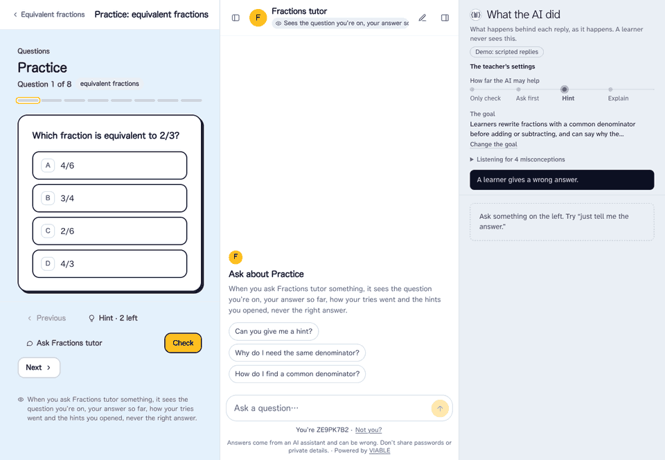

<p align="center">
  
</p>

<p align="center">
  <a href="https://github.com/VIABLE-Learning-Lab/viable/actions/workflows/test.yml"></a>
  <a href="LICENSE"></a>
  <a href="NOTICE"></a>
  
</p>

**The VIABLE Open Kit: tools for AI that teaches the way a teacher wants.** Left alone, a model replies generally: it gives the
answer, explains too much, and answers everyone alike. What it lacks isn't intelligence. It doesn't know the goal, how much
help is right today, or what this learner's mistake suggests.

## Which part is yours?

| You have | You want | Take | Start |
| --- | --- | --- | --- |
| A class to teach | To say what you're teaching and use it today, with nothing to install | **[VIABLE Learning Platform](https://www.viablelearning.org)** | Hosted, and not in this repository |
| An AI agent or an education product | It to know how to teach, whatever it's built on | **[VIABLE Harness](harness/README.md)** | `npx skills add VIABLE-Learning-Lab/viable --skill teaching-with-viable` |
| A coding agent, and an idea for something learners will use | It to know what a classroom needs while it builds | **[VIABLE Harness, for builders](harness/docs/for-builders.md)** | `npx skills add VIABLE-Learning-Lab/viable --skill building-for-learners` |
| A school, a library or a lab, and your own server | AI tutors, courses and class lists you run yourself, on any model | **[VIABLE Engine](engine/README.md)** | `npx github:VIABLE-Learning-Lab/viable start` |
| A course or an agent on the Developer Platform | To move it to your own server | **[VIABLE Engine](engine/README.md#from-the-viable-developer-platform)** | Download it as a package, then add it |
| A study to run, or a workflow to build by drawing it | A visual editor, consent, a research export, with nothing to host | **[VIABLE Developer Platform](https://developers.viablelab.org)** | Hosted |
| A research method: guidance, a way to check or rate replies, a detector | Teachers' AIs to use it, with your citation | **[A component](harness/docs/components.md)** | [Add your research](harness/docs/add-your-research.md) |
| A dataset or a benchmark | AI tutors tested on it, with your citation | **[A catalog entry](harness/docs/resources.md#add-a-dataset-or-a-benchmark)** | [A catalog issue](https://github.com/VIABLE-Learning-Lab/viable/issues/new?template=catalog.yml) |

You take only what you need. A Skill is a few text files; the Harness is a package with no dependencies and nothing of the
Engine in it. They live in one repository because one small team looks after both.

## See it work

```sh
npx github:VIABLE-Learning-Lab/viable
```

No key, nothing to set up. It opens a real course on your computer with a panel beside it, showing what the AI was given
before it wrote a word. Without a key the model's words are scripted, and it says so
([more](engine/docs/try.md)). It keeps nothing. `npx github:VIABLE-Learning-Lab/viable start` is the real thing: your own server,
set up in the browser.

<p align="center">
  
</p>

## How it fits together

<p align="center">
  
</p>

**The Harness** decides what a model has in mind before it replies, what it may do, what happens next, whether the reply met
the bar, and what the evidence says should change.

**The Engine** is everything else it takes to run AI in a class: agents, courses, class lists, learner pages and a console in your
browser, where you add a model and what it makes possible turns on, write how the AI helps in an activity, paste a class list, and
see who has done what. It is built on the Harness.

**The hosted platforms** run this same code. The [Developer Platform](https://developers.viablelab.org) adds a visual workflow
editor, studies with consent, and a documented research export. Nothing here depends on them.

## Privacy and safety

This is used with minors, so its defaults protect them wherever it runs:

- No learner's name or identifier is sent to a model. What the AI is told is set per activity or group, never per learner.
- What is hidden from learners never reaches their browser: answer keys, instructions, a teacher's notes.
- A brief holds the teacher's words and the resources' own text, never the learner's, so a learner can change what is chosen but
  can't write instructions into it.
- A component receives only the learner data its manifest lists. A package can't start a program on your machine unless you name it.
- A reply that wasn't checked says so. It is never shown as checked.
- A server of your own answers only your own machine until you set a token, and its logs hold no learner's words.

Running this doesn't make a deployment compliant with COPPA, FERPA or any other law by itself:
[deploying.md](engine/docs/deploying.md) lists what you still have to do. Report vulnerabilities privately
([SECURITY.md](SECURITY.md)).

## Reading the docs

The same documents, easier to read, with [how it works](https://developers.viablelab.org/docs/how-it-works) to try and a [library](https://developers.viablelab.org/docs/library) of what it knows: [developers.viablelab.org/docs](https://developers.viablelab.org/docs). They are written here, and the site is generated from them.

## Status

Version 0.3, a preview. What each README describes is built and tested. Not yet: the packages on npm (until then, clone this
repository and use `harness/bin/viable-harness.mjs` and `engine/bin/viable-engine.mjs`), a real deploy to each cloud, and an
LTI 1.3 connection for school learning management systems. The formats, the command lines and the functions follow semantic
versioning ([CHANGELOG](CHANGELOG.md)).

## Contributing

Issues, discussions and pull requests are welcome, from a typo to a new component or catalog entry.
[CONTRIBUTING.md](CONTRIBUTING.md) covers setting up, testing and how a pull request lands. Look for
[good first issues](https://github.com/VIABLE-Learning-Lab/viable/labels/good%20first%20issue), ask in [Discussions](https://github.com/VIABLE-Learning-Lab/viable/discussions), and follow the
[code of conduct](CODE_OF_CONDUCT.md).

## Citing and license

If you use this in research, cite it with [CITATION.cff](CITATION.cff). Code under [MIT](LICENSE). The data it carries stays under
its own licenses, with the attribution to keep, in [NOTICE](NOTICE). The names VIABLE and VETTING:
[TRADEMARKS.md](TRADEMARKS.md).

Made by [VIABLE Lab](https://viablelab.org).
