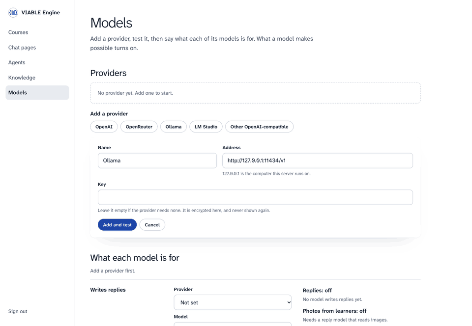

# VIABLE Engine

**AI tutors, courses and class lists on your own server, set up in the browser.**

For a school, a library or a lab that wants to run this on its own machines, with any model. Nothing here needs VIABLE's hosted
service. Adding a model turns on the features it supports.

<p align="center">
  
</p>

<sub>A real server, from empty. Only the model's words are scripted here.</sub>

## Ten minutes, from nothing to a class

```sh
npx @viable-lab/engine start
```

It keeps everything in `~/.viable-engine`, and opens its console, signed in.

1. **Models.** Add a provider (OpenAI, OpenRouter, Ollama, LM Studio, or any OpenAI-compatible address), test it, and say what each
   of its models is for.
2. **Courses.** Start from nothing, from an example, or from a file.
3. **An activity.** Say what learners do, the goal, and how much the AI does. Type what a learner might say to see exactly what the
   AI would be told at that moment. **Try it**, as a learner, without being counted, with what the AI did beside it and
   another help level to try. Then open it.
4. **People.** Let anyone with the link in, or paste your class list and print a card for each learner with their personal code.
5. **Share** the link or its QR code. A class on your network needs `--host 0.0.0.0`, on a network you trust, since that's plain
   http; a class anywhere needs a [server](#where-it-runs) on https.

Then **Progress** shows who has done what, what to look at, and any change the evidence suggests, which you can accept with one
button.

What you change reaches learners on their next message. There is nothing to restart and nothing to publish.

**Or just say it.** With a model set, the console opens on **Ask**: say what you're teaching, and it makes the course, the activities and the questions, showing each step as it works, and hands back cards to use, such as the link, its QR code and the class list. To change what's there, bring a course or an activity into the conversation, from its page or from the + in the box. With a model that hears, you can say it instead of typing. It can't change what learners can already reach, open anything to them or delete anything: that waits for your click, enforced on the server. A class list goes in its own box, and names never reach the model.

## What each model turns on

| Role | Calls | What it makes possible |
| --- | --- | --- |
| Writes replies | `/chat/completions` | Replies, word by word. Photos and PDFs from learners, if you say this model reads them |
| Reviews replies | `/chat/completions` | A second model in an agent's check step |
| Sets up classes *(optional)* | `/chat/completions`, with tools | Ask. Otherwise it uses whichever writes replies |
| Reads the moment *(optional)* | `/chat/completions` | A small model picks what each turn needs, in any language. Otherwise rules do, best in English |
| Hears learners | `/audio/transcriptions` | The microphone: a voice message, dictation, a conversation by voice |
| Reads aloud | `/audio/speech` | Replies read aloud, and an agent's Speech step |
| Draws pictures | `/images/generations` | An agent's Image step |
| Searches by meaning | `/embeddings` | Knowledge search by meaning as well as keywords |

The console shows each one on or off, and why. Keys are encrypted where they are kept, and never come back to a browser.

**Care or speed is yours to weigh.** A check holds a reply back until it passes, so a learner waits for each try, and a strict reviewer adds seconds to every reply. An agent's page sets how many tries, Models sets how fast a reviewer, and Progress says how long learners
have been waiting.

## A chat button on your website

A library wants research help on its guides' pages, answering from its own guides, on its own server.

1. **Knowledge.** Make a knowledge base, add the guides as files or read them from your website.
2. **Chat pages.** Make a page: its instructions, its knowledge base, how many messages a visitor gets.
3. Copy the one line onto your site, and say which sites may show it.

```html
<script src="https://your-server/embed.js" data-agent="research-help" async></script>
```

Anyone who can open it can use it on your model keys, up to the limits you set.

## From the VIABLE Developer Platform

On the VIABLE Developer Platform, download the course or agent as a package with its files (Courses → ⋯ → Export). In the console:
**Courses → From a file**. Or start with it:

```sh
npx @viable-lab/engine start course.viable.zip
```

| Travels | Stays behind |
| --- | --- |
| Activities, question sets, How the AI helps (the setting for how much help the AI gives), agents and their look, chat page settings, knowledge files, website snapshots | Learners and their work, class lists, keys, study data |

A workflow built in the Developer Platform's visual editor runs here as it is: you can't redraw it in the console, and you can change its look and page.
The other way works too: **Settings → Download**, then import it on the VIABLE Developer Platform, where models it doesn't have become
its default, and it says so.

## From fixed to free, step by step

An agent is steps you connect, and how much each leaves to the model is yours to set:

| When it should | Use | The model decides |
| --- | --- | --- |
| Do the same every time: search, then answer, then check | Steps in a row | The words |
| Take one of a few paths | A Router step, or a Branch on what an earlier step found | Which path |
| Do whatever a question needs, from what you allow | An **Agent step**: it searches and reads your knowledge, remembers, reads a web page, hands off to another agent, and calls tools you draw from other steps, such as a picture, an API or a research component | Which tools, in what order, and when it has enough |
| Repeat for every item of a list | A For each step | Nothing: the list decides |

What has to hold every time stays a step, whatever else is free. How the teacher wants the AI to help goes to the steps that write
the reply and to the review. A tool a teacher switched off is removed, not only forbidden. VETTING is a review step: a second model checks a reply against the teacher's rules before the learner sees it. Put one
after an Agent step to review what the Agent wrote. Every run keeps each step and tool call, so a study can say what a version did.

## Where it runs

`viable-engine deploy <target> [package] --out <folder>` writes a folder with its own README and exact commands, and you deploy it
yourself. With no package, the server starts empty and you set it up at `/console`. A course changed there stays in the store.

| Target | Keeps things in | How far it has been tried |
| --- | --- | --- |
| `node` | a folder | run by the tests |
| `docker` | a volume | run under Docker |
| `cloudflare` | D1 | run with `wrangler dev --local` |
| `firebase` | Firestore | run in the Functions emulator; never deployed |
| `aws-lambda` | an S3 bucket | its handler tested; never deployed |
| `cloud-run` | a Cloud Storage bucket as a folder | its image run under Docker; never deployed |

## What it keeps, and who sees it

Everything stays in your store. A learner's name lives only on the class list, and is never sent to a model. Learner records carry a
pseudonymous code. `--keep-days <n>` deletes what learners wrote after that many days, and
`viable-engine forget <code> --data-dir ~/.viable-engine` deletes one learner. [deploying.md](docs/deploying.md) lists what the code guarantees, and what is
still yours to do, such as your agreement with each model provider.

## More than the console

```sh
viable-engine start                                 # the console, on a folder of its own
viable-engine serve course.viable.zip --port 8080   # one package, with your flags
viable-engine run agent.json --input "..."          # one reply, in a terminal
viable-engine inspect course.viable.zip             # what it needs, before you run it
viable-engine verify https://your-server            # whether a server works
```

Apps call the same API as the hosted platform (`POST /v1/agents/<slug>/runs`), so they move by changing an address.
[self-hosting.md](docs/self-hosting.md) is the reference: flags, the API, what differs from VIABLE. Others:
[learner-pages.md](docs/learner-pages.md), [deploying.md](docs/deploying.md), [try.md](docs/try.md).

**Not here:** the visual workflow editor, studies with consent and the research export stay on the
[VIABLE Developer Platform](https://developers.viablelab.org). LTI isn't built. The Engine is built on the
[VIABLE Harness](../harness/README.md), which you can use without any of this.
