# Computed diagnosis, checked three ways

Naming a learner's mistake by computing it, checked against asking a model and on another team's cases.

The Harness names the faulty procedure behind a wrong answer by applying each procedure it knows to the problem and
seeing which gives what the learner wrote ([`src/diagnose.js`](../../src/diagnose.js)). [The scorecard](../../docs/scorecard.md)
scores that on this project's own cases. The three checks here ask what the scorecard can't: is computing better than
asking a model, and does it hold on cases someone else made?

No learner is involved in any of them. They measure whether a name or a prediction matches a label.

<p align="center">
  
</p>

| Check | Cases | Models asked |
| --- | --- | --- |
| 1. Code against a model asked the same question | 80 wrong answers, the test half of the scorecard's set | `gpt-6-luna`, `gpt-oss-120b`, `gemma-4-31b-it` |
| 2. On wrong answers from another library | MalruleLib's 4,991 problems. Code takes the 547 that are two numbers and one operation | None |
| 3. On MalruleLib's own task | Its 12,706 pairs, of which 779 are in scope. 200 of them put to models | `gemma-4-31b-it`, `gpt-oss-120b` |

Every answer a model gave is in [`runs/`](runs/), by case and by pair, so the commands below print the tables again
without a model: with no key set, they only read the kept answers. Set `OPENAI_BASE_URL` and `OPENAI_API_KEY` to have a
model answered again, and the new answers are added to the file `--kept` names.

## 1. Code against a model asked the same question

The same 80 wrong answers (the test half of [`wrong-answers.json`](../../scorecard/wrong-answers.json)), the same 66
procedures to choose from, the same labels. Code computes. Each model is shown the problem, the learner's answer and
the list, and told to work a procedure through before choosing it, or to answer "none".

```sh
node evals/diagnosis/ask-a-model.mjs --models gpt-6-luna,gpt-oss-120b,gemma-4-31b-it --kept evals/diagnosis/runs/asked.jsonl
```

| | Names the labelled procedure | Names another | Gives a slip a procedure |
| --- | ---: | ---: | ---: |
| Code, no model | 70% (56 of 80; 59 to 79) | 10% (8; 5 to 19) | 0 of 6 |
| `gpt-6-luna`, asked | 71% (57; 61 to 80) | 21% (17; 14 to 31) | 2 of 6 |
| `gpt-oss-120b`, asked | 63% (50; 52 to 72) | 34% (27; 24 to 45) | 3 of 6 |
| `gemma-4-31b-it`, asked | 44% (35; 33 to 55) | 56% (45; 45 to 67) | 6 of 6 |

Each range is a 95% interval. Code and the models answer the same 80 cases, so the differences are taken case by case:

| Code against | Names the labelled procedure, points | Names another, points |
| --- | ---: | ---: |
| `gpt-6-luna` | -1.3 (-6.3 to 3.8) | -11.3 (-18.8 to -5.0) |
| `gpt-oss-120b` | +7.5 (0.0 to 16.3) | -23.8 (-33.8 to -13.8) |
| `gemma-4-31b-it` | +26.3 (16.3 to 37.5) | -46.3 (-57.5 to -35.0) |

Code finds as many as the best of the three models and names a wrong procedure on 11 fewer answers in 100 than that
model, 24 fewer than the larger open-weight model and 46 fewer than the smaller. The difference is in what happens when
there is nothing to find: code says nothing, and the models name something. The smallest model, the kind a district
could run on its own server, never answered "none" and was wrong more often than right.

A tutor that is told the wrong misconception teaches to it, so the middle column is the one that costs a learner.

## 2. On wrong answers from another library

[MalruleLib](https://github.com/sonkar-lab/malrulelib) (Chen, Liu & Sonkar, 2026, arXiv 2601.03217) holds 101 faulty
procedures in school mathematics as code, and 4,991 generated problems with the wrong answer each procedure gives. Its
license allows research and open-source use and forbids commercial use, so none of it is in this repository. Clone it
beside this one:

```sh
git clone https://github.com/sonkar-lab/malrulelib && git -C malrulelib checkout 8ddedfb
node evals/diagnosis/malrulelib.mjs malrulelib/data/raw_data.csv --rules
```

Nothing is matched by hand. The script counts how many of their problems are in scope (two numbers and one
operation), how many of their wrong answers get a name, and whether one of their procedures keeps getting the same
name of ours.

| | As found | After |
| --- | ---: | ---: |
| Problems read as two-number arithmetic | 660 | 542 |
| of those, read wrongly (another right answer than theirs) | 94 | 2 |
| Wrong answers named, of those read rightly | 333 of 547 (60.9%) | 361 of 540 (66.9%) |
| Named answers carrying the name most often given to their procedure | 88.3% | 87.5% |

"As found" is the code before anything was changed because of this library, and is the estimate of how the procedures
do on cases they weren't written from. "After" was reached by reading this same data, so it only says the gaps found
are closed. (The first run also left out 19 problems whose key is a rounded decimal or a pair for a fraction.)

About one problem in nine is in scope: most of MalruleLib is algebra, exponents, radicals, statistics and geometry.

The 94 misreadings were the useful finding. The reader took `|3x - 4| when x = -3` for 3 × -4, `√(3+1)` for 3 + 1, and
a word problem with three numbers for the two inside its brackets. A wrong reading gives a wrong right answer, and then
a confident name for a mistake nobody made. The reader now refuses a problem with a root, a power, an absolute value,
an equals sign before the numbers, a letter beside them, or any other number in it.

Four more changes came from where their answers went unnamed: a decimal cut short is the longer one (7.11 for 64/9);
an answer that is one of the problem's own numbers counts when it stands alone or ends a line of working (7/9 for
1/9 × 7/9); and two procedures from the classic lists of arithmetic bugs were added (Brown & Burton, 1978), the carried
digit never added when multiplying and the points left out of a sum. Still without a name are their borrowing variants
in column subtraction, misaligned rows in multi-digit multiplication, and carrying the wrong digit when adding.

## 3. On MalruleLib's own task: the learner's next answer

MalruleLib's paper asks models to infer a misconception from one worked mistake and predict the same student's answer
to another problem. Across nine models it reports 66% on solving the problems and 40% on predicting the answer when the
second problem is from another template.

A procedure that is code can do this directly: name the procedure behind the first answer, apply it to the second
problem ([`applyProcedure`](../../src/diagnose.js)). Of their 12,706 pairs, 779 have both problems in scope.

```sh
node evals/diagnosis/predict-next.mjs malrulelib/data/experiment_pairs.csv --models gemma-4-31b-it,gpt-oss-120b --sample 200 --kept evals/diagnosis/runs/predicted.jsonl
```

On every pair in scope, code predicts the next answer exactly on 62.5% of the 504 same-template pairs and 40.0% of the
275 cross-template pairs, predicts another answer on 3.0% and 7.6%, and makes no prediction on the rest.

Two open-weight models were asked the same question on 200 of those pairs, 100 of each kind (the license allows
evaluating models whose weights are public):

| On the same 200 pairs | Same template: right, wrong, none | Cross template: right, wrong, none |
| --- | --- | --- |
| Code | 60%, 6%, 34% | 45%, 7%, 48% |
| `gemma-4-31b-it`, asked | 58%, 42%, 0% | 33%, 65%, 2% |
| `gpt-oss-120b`, asked | 79%, 19%, 2% | 56%, 41%, 3% |
| Code, then `gemma-4-31b-it` where code has no prediction | 73%, 27%, 0% | 60%, 39%, 1% |
| Code, then `gpt-oss-120b` where code has no prediction | 79%, 19%, 2% | 63%, 34%, 3% |

When code makes a prediction it is right about nine times in ten, and it makes one for half to two thirds of the
pairs. The larger model gets more pairs right than code and is wrong three to six times as often. Putting code first helps
both: on cross-template pairs the small model goes from 33% right to 60%, and the larger from 56% to 63%, each with
fewer wrong predictions. With 100 pairs in each cell, a difference under about 14 points could be chance.

This is how the Harness uses a diagnosis in a turn. The instructions say what the answer shows only when code found a
procedure, and otherwise leave the model to work it out, as it would have without the Harness.
